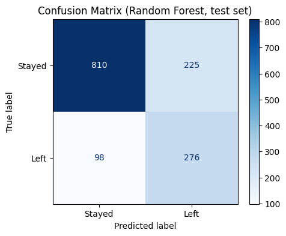
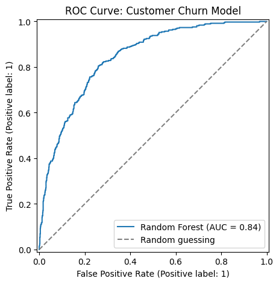
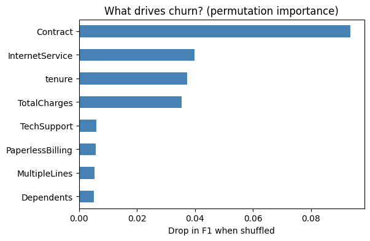
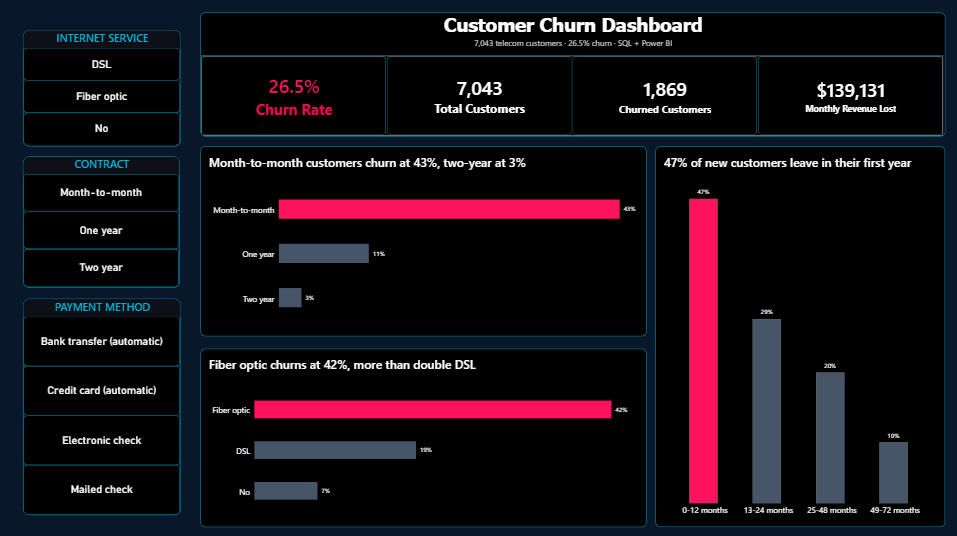

# Customer Churn Prediction

Predicts which telecom customers are likely to leave, using scikit-learn pipelines and stratified cross-validation, and shows which factors drive churn.

## Data
- Customer Churn data (7,043 customers, 21 columns, target `Churn`), provided with the Intellipaat Data Science course capstone project
- 26.5% of customers churned, so always predicting "stay" gives 73.5% accuracy (the baseline to beat)
- Not included in this repo. Place `customer_churn.csv` in the same folder as the notebook to run it.
- The dataset and the starting task came from the course. The pipeline, model comparison, evaluation, cutoff and lift analysis, and conclusions are my own work.
  
## Approach
1. Converted `TotalCharges` to numbers (11 blanks for brand-new customers, filled with the median inside the pipeline) and dropped `customerID`
2. 80/20 stratified train/test split (seed 42)
3. Scaling and one-hot encoding inside a pipeline, fitted on training data only (no leakage)
4. Compared 4 models with stratified 5-fold CV on the training data
5. Evaluated the best model once on the held-out test set

## Results
5-fold cross-validation (training data):

| Model | Accuracy | Precision | Recall | F1 | ROC-AUC |
|---|---|---|---|---|---|
| Majority baseline | 0.735 | 0.000 | 0.000 | 0.000 | 0.500 |
| Logistic Regression | 0.749 | 0.517 | 0.801 | 0.629 | 0.846 |
| Decision Tree | 0.742 | 0.510 | 0.777 | 0.615 | 0.827 |
| Random Forest | 0.775 | 0.559 | 0.724 | 0.631 | 0.845 |

Test set (1,409 customers), Random Forest: accuracy 0.771, churn precision 0.55, **recall 0.74**, **F1 0.63**, **ROC-AUC 0.842**.
It caught 276 of 374 churners, with 225 false alarms and 98 missed.





**Cutoff trade-off:** at 0.5 the model flags 501 customers (recall 0.74); at 0.4 it flags 599 (recall 0.82, same F1 0.63).

**Lift:** the riskiest 10% of customers hold 29% of all churners (2.9x), and the riskiest 20% hold 50% (2.5x).

**Main drivers** (permutation importance):



**Tuning:** randomized search improved cross-validated F1 only from 0.631 to 0.637, so the default settings were already good.

## SQL analysis and Power BI dashboard
I loaded the data into SQLite, cleaned it with SQL, and ran 11 analysis queries (GROUP BY, CTEs, RANK and running-total window functions). The cleaned data feeds an interactive Power BI dashboard.



[Full dashboard (PDF)](PowerBI/Churn_Dashboard_Overview.pdf)

**Key findings**
- Month-to-month customers churn at 43%, one-year at 11%, two-year at 3%
- 47% of customers leave in their first 12 months, versus 10% after 4 years
- Fiber optic customers churn at 42%, DSL at 19%
- Electronic check payers churn at 45%, credit card payers at 15%
- Month-to-month + fiber optic + first year is the riskiest group: 916 customers, 70% churn

## Conclusions
- Contract type is the strongest churn driver, followed by internet service and tenure.
- A retention team can reach about half of all churners by contacting the riskiest 20% of customers.
- The three models perform about the same, so a simple, explainable model like logistic regression is a reasonable choice.

## Limitations
- One dataset, provided with the course; results may not transfer to other companies.
- No time dimension: the model uses a snapshot of each customer.
- Patterns are descriptive, not proof of cause.

## Repository contents
- `Telco_Customer_Churn.ipynb`: modeling notebook (pipelines, cross-validation, cutoff and lift analysis)
- `SQL/`: SQLite analysis (data quality checks, cleaning, 11 queries with CTEs and window functions) and `run_pipeline.py`
- `PowerBI/`: Power BI dashboard (PNG screenshot and PDF export)
- `images/`: saved charts used in this README
- `requirements.txt`: Python packages needed

## How to run
**Notebook**
```bash
pip install -r requirements.txt
jupyter notebook Telco_Customer_Churn.ipynb
```
**SQL pipeline** (needs Python 3.8+ with SQLite 3.25+, which ships with current Python)
```bash
python SQL/run_pipeline.py customer_churn.csv
```
It creates `churn.db`, `results/` (11 query outputs) and `powerbi_data/` (CSV files for Power BI).

Put `customer_churn.csv` in the same folder. It is not included in this repo.

## Tech stack
Python, Pandas, NumPy, Scikit-Learn, Matplotlib, SQL (SQLite), Power BI
